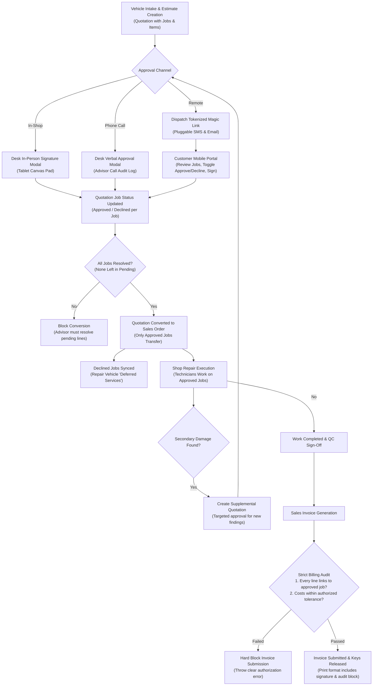

# Automotive Quotation Approval System Specification

## 1. Overview and Core Purpose

This specification defines the customer authorization and quotation approval system for the `ism` automotive repair application.

### The Shop Mandate
Every repair job performed in the shop and billed to a customer must possess verified customer authorization. Unauthorized work and unapproved charges are strictly prohibited.

### Key Objectives
1. **Per-Job Granularity**: Authorize individual repair operations (jobs) rather than only the quotation as a single bulk document. Support partial approvals where customers accept critical safety repairs and decline elective services.
2. **Multi-Channel Evidence**: Capture verifiable consent through three distinct channels:
   - **Remote Digital Link**: Tokenized, expiring mobile web link sent by SMS and email.
   - **In-Person Digital Signature**: Desk- or tablet-based signature capture pad.
   - **Verbal Phone Authorization**: Structured desk modal capturing call timestamp, caller contact, advisor credentials, and spoken confirmation details.
3. **Mid-Repair Supplement Workflow**: Handle secondary findings discovered during vehicle teardown through linked Supplemental Quotations that append approved jobs directly to the active Repair Order.
4. **Strict Enforcement Gates**: Enforce hard validation blocks at Sales Order generation and Sales Invoice submission. Prevent technician execution and customer billing for any unapproved items.
5. **Configurable Cost Tolerance**: Protect shop profitability while complying with automotive repair regulations by enforcing a configurable tolerance threshold before blocking invoices for cost overruns.
6. **Legal Audit and Documentation**: Persist all authorization metadata and signature images. Render clear customer authorization blocks directly on printed Repair Orders and Invoices.
7. **Deferred Service Retention**: Automatically sync declined jobs to the vehicle record to power future service recommendations and protect the shop against liability.

---

## 2. End-to-End Approval Lifecycle Architecture



---

## 3. Data Model and Schema Architecture

### 3.1. Quotation Job (`Quotation Job`)
A child table attached to `Quotation` (and mirrored on `Sales Order` and `Sales Invoice`) representing a discrete repair operation bundling labor and parts.

| Field Name | Type | Options / Detail | Description |
| :--- | :--- | :--- | :--- |
| `job_title` | Data | Mandatory | Operation name (e.g., "Front Brake Pad & Rotor Replacement") |
| `job_category` | Select | Maintenance, Diagnostic, Mechanical, Electrical, Tires | Classification of work |
| `service_package` | Link | `Service Package` | Optional link to standard canned job template |
| `status` | Select | `Draft`, `Pending Approval`, `Approved`, `Declined` | Approval status of this specific job |
| `approval_channel` | Select | `In-Person Signature`, `Remote Web Link`, `Verbal Phone Authorization` | Method used to capture authorization |
| `estimated_total` | Currency | Read-only calculation | Calculated sum of parts and labor lines linked to this job |
| `authorized_amount` | Currency | Read-only on approval | Exact monetary cap authorized by customer at time of approval |
| `authorized_by` | Data | String | Name of customer contact who authorized the job |
| `authorized_at` | Datetime | Timestamp | Exact date and time authorization was granted |
| `advisor` | Link | `User` | Service advisor who presented or recorded the authorization |
| `verbal_notes` | Small Text | Optional | Summary notes if authorized by phone |
| `signature_image` | Attach Image | Private file | Image file containing captured electronic signature |
| `audit_hash` | Data | 64-char string | Cryptographic verification hash (SHA-256) of approval payload |
| `ip_address` | Data | 45-char string | Client IP address for remote web authorizations |
| `user_agent` | Small Text | String | Browser and operating system signature of approving device |
| `is_supplement` | Check | 0 or 1 | Flag indicating this job was added as a secondary supplement |

### 3.2. Quotation Item Enhancements (`Quotation Item`)
Standard ERPNext `Quotation Item` rows (labor operations and spare parts) link to their parent job.

| Field Name | Type | Target | Description |
| :--- | :--- | :--- | :--- |
| `custom_job` | Data | Matches `name` in `Quotation Job` | Links this item row directly to a specific `Quotation Job` |
| `custom_job_title` | Data | Read-only | Name of the parent job for grid visibility and reporting |

### 3.3. Service Package Masters (`Service Package` and `Service Package Item`)
Standalone DocTypes providing canned job templates for one-click insertion.

- **`Service Package`**:
  - `package_name` (Data, Unique)
  - `category` (Select)
  - `description` (Small Text)
  - `standard_labor_hours` (Float)
  - `items` (Table: `Service Package Item`)
- **`Service Package Item`**:
  - `item_code` (Link: `Item`)
  - `qty` (Float)
  - `is_labor` (Check)

### 3.4. Repair Vehicle Deferred Service Log (`Vehicle Deferred Service`)
Child table on `Repair Vehicle` persisting unapproved and declined work for customer retention and legal liability records.

| Field Name | Type | Description |
| :--- | :--- | :--- |
| `job_title` | Data | Name of the declined operation |
| `decline_date` | Date | Date customer declined the work |
| `quotation` | Link (`Quotation`) | Source quotation reference |
| `estimated_amount` | Currency | Quoted cost at time of decline |
| `decline_reason` | Small Text | Customer explanation (e.g., "Will do next month", "Budget constraint") |
| `safety_hazard` | Check | Checked if declined repair creates immediate vehicle safety risk |
| `status` | Select | `Open Recommendation`, `Completed Later`, `Cancelled` |

### 3.5. ISM Settings Enhancements (`ISM Settings`)
System-level configuration for approval workflows and tolerance controls.

| Field Name | Type | Default | Description |
| :--- | :--- | :--- | :--- |
| `authorization_token_expiry_hours` | Int | `48` | Lifespan of remote approval magic links |
| `cost_tolerance_percentage` | Percent | `10.0` | Permitted invoice variance above authorized amount without re-authorization |
| `cost_tolerance_flat_amount` | Currency | `25.0` | Maximum monetary buffer above authorized amount |
| `sms_gateway_provider` | Select | `Custom HTTP Webhook`, `Twilio`, `Disabled` | Outbound SMS messaging provider |
| `sms_gateway_endpoint` | Data | URL | Target webhook URL for custom messaging provider |
| `sms_gateway_api_key` | Password | Secret | Authentication credential for custom provider |
| `sms_sender_id` | Data | String | Registered SMS sender alphanumeric ID or originating phone number |
| `disclaimer_text` | Text | Standard Text | Legal repair disclaimer text presented during customer signing |

---

## 4. Customer Authorization Channels and Workflows

### 4.1. Remote Digital Approval (SMS & Email Web Link)
1. **Token Generation**:
   - When an advisor clicks **"Send for Customer Approval"**, the system generates a secure, cryptographically random 32-byte URL token (`token = frappe.generate_hash(length=32)`).
   - Token is stored in `Quotation` with an `approval_token_expiry` timestamp (`now_datetime() + timedelta(hours=expiry_hours)`).
2. **Dispatch**:
   - Dispatches an SMS via the custom SMS gateway and an email via standard Frappe Mail.
   - Message: *"Hello [Customer Name], please review and authorize the repair estimate for your [Vehicle]: [URL]"*.
   - Desk provides a **"Copy Approval Link"** button for manual dispatch via messaging apps.
3. **Customer Mobile Web Portal (`/quote-approval?token=<token>`)**:
   - Responsive, clean interface requiring no password or registration.
   - Displays vehicle summary: License plate, VIN, make/model, current odometer.
   - Lists each proposed job with itemized parts, labor, and subtotal.
   - Per-job toggle: `[ Approve ]` or `[ Decline ]`.
   - Dynamic real-time calculation of total authorized amount and taxes.
   - Required input: Signer Name.
   - Interactive HTML5 canvas signature pad allowing customer to draw their signature with touch or mouse.
   - Checkbox: *"I authorize the selected repair services and associated parts under the shop terms and conditions."*
4. **Submission and Lockout**:
   - Customer clicks **"Submit Authorization"**.
   - Server validates token expiration and active status.
   - Records signature as a private `File` linked to the Quotation.
   - Updates each `Quotation Job`:
     - Approved jobs set to `Approved`, capturing `authorized_amount = current_job_total`.
     - Declined jobs set to `Declined`.
   - Records audit metadata: Client IP address, browser User-Agent, UTC timestamp, SHA-256 hash.
   - Token status changes to `Submitted`. Subsequent visits to the URL display a read-only confirmation receipt displaying the signed choices and timestamp.
   - Quotation status updates to `Customer Approved`, and the assigned service advisor receives a Frappe Desk notification.

### 4.2. In-Person Tablet Signature Modal
1. Advisor clicks **"Capture In-Person Signature"** on the Quotation in Desk.
2. A responsive modal displays the list of jobs with toggle switches for `Approve` / `Decline`.
3. Customer inspects the screen, verifies the selected jobs, and signs directly on the tablet screen inside a canvas signature pad.
4. Advisor clicks **"Confirm Authorization"**.
5. System attaches signature image, marks jobs as `Approved` or `Declined`, records `approval_channel = 'In-Person Signature'`, and updates the Quotation.

### 4.3. Verbal Phone Authorization Modal
1. Advisor clicks **"Log Verbal Authorization"** on the Quotation.
2. Desk dialog prompts the advisor for:
   - `Customer Phone Number` (auto-filled from customer record).
   - `Customer Contact Person` (person spoken to).
   - Job selection checkboxes (`Approve` / `Decline` per job).
   - `Advisor Call Notes` (mandatory text field detailing the conversation).
3. System records:
   - `approval_channel = 'Verbal Phone Authorization'`
   - `authorized_by = [Contact Person]`
   - `advisor = [frappe.session.user]`
   - `authorized_at = [now_datetime()]`
   - `verbal_notes = [Call Notes]`

---

## 5. Mid-Repair Supplements (Additional Work Discovery)

When a technician identifies secondary repairs during vehicle teardown:

```
[ Active Sales Order / Repair Order ]
               │
               ▼ (Advisor clicks "Create Supplement")
[ Supplemental Quotation Generated ]
  - Links to parent Sales Order
  - Pre-fills Vehicle, Customer, and Check-In
  - Contains ONLY new supplemental jobs
               │
               ▼ (Customer authorizes via Remote Link / In-Person / Phone)
[ Customer Authorizes Supplement ]
               │
               ▼ (Automated Handoff)
[ Approved Jobs & Items Automatically Appended to Active Sales Order ]
  - New jobs added to Sales Order job table with supplement flag
  - Sales Order item table receives new parts and labor lines
  - Sales Order total updates
  - Technicians can now dispatch and clock in on new jobs
```

### Technical Rules for Supplements:
1. The Supplemental Quotation carries `custom_supplement_for = [Sales Order Name]`.
2. Initial jobs already authorized on the primary quote do not appear on the supplement link; the customer is only prompted to authorize the newly discovered work.
3. Upon supplement approval, a server-side routine appends approved jobs and items into the active `Sales Order` without canceling or restarting the existing document.

---

## 6. Strict Validation Gates and Gating Enforcement

### Gate 1: Sales Order Conversion (Pre-Repair Execution Gate)
- **Quotation Submission Lifecycle**: Service advisors first submit the `Quotation` (`docstatus = 1`) to freeze the repair estimate. Submitting automatically transitions jobs and estimate status from `Draft` to `Pending Approval`. The submitted quotation is then presented to the customer for authorization.
- **Rule 1.1 (Resolution Completeness)**: A Quotation cannot be converted into a Sales Order if any `Quotation Job` remains in `Draft` or `Pending Approval`. Every job must have an explicit status of either `Approved` or `Declined` before a Sales Order can be created.
- **Rule 1.2 (Minimum Approval)**: A Quotation cannot be converted to a Sales Order if zero jobs are approved. At least one job must be `Approved`.
- **Rule 1.3 (Approved-Only Transfer)**: The standard "Make -> Sales Order" mapper is overridden. Only `Quotation Item` rows belonging to `Approved` jobs are transferred into the Sales Order. Items linked to `Declined` jobs are excluded.
- **Rule 1.4 (Automated Deferred Sync)**: Any jobs marked `Declined` are automatically copied into the `Repair Vehicle` document's `deferred_services` child table.

### Gate 2: Active Repair Order Execution (`Sales Order`)
- **Rule 2.1 (Job Linkage)**: Every line in the Sales Order `items` table must link to an approved `Quotation Job`.
- **Rule 2.2 (Execution Lock)**: Technician time tracking and parts issuance validate that the target job is in `Approved` status.

### Gate 3: Invoicing and Billing Audit (`Sales Invoice`)
- **Rule 3.1 (Authorization Verification)**: On `validate` and `on_submit` of `Sales Invoice`, the system audits every billed item:
  - Each item must trace back to an authorized job originating from the approved Quotation or approved Supplement.
- **Rule 3.2 (Cost Tolerance Audit)**:
  - For each job, the system calculates:
    $$\Delta = \text{Billed Job Amount} - \text{Authorized Job Amount}$$
  - If $\Delta > 0$, the system checks:
    $$\text{Permitted Buffer} = \min(\text{Authorized Amount} \times \frac{\text{Tolerance \%}}{100}, \text{Flat Tolerance Buffer})$$
  - If $\Delta > \text{Permitted Buffer}$, the system raises a validation error:
    > *"Cannot submit Sales Invoice: Billed total for job '{0}' (${1}) exceeds the customer-authorized limit (${2}) plus permitted tolerance (${3}). A supplemental customer authorization is required."*

---

## 7. Pluggable SMS Gateway Specification

Because the target messaging provider is not natively integrated in Frappe, ISM provides a dedicated, decoupled SMS dispatch architecture.

### 7.1. Dispatch Interface
File: `ism/api/sms.py`

```python
def dispatch_sms(phone_number: str, message: str) -> dict:
    """Dispatches SMS using configured ISM Settings provider.
    
    Returns:
        dict: {"success": bool, "message_id": str, "error": str}
    """
```

### 7.2. Custom Webhook Configuration
When `sms_gateway_provider == "Custom HTTP Webhook"`, the system executes an HTTP POST to `sms_gateway_endpoint` with:
- **Headers**: `{"Authorization": "Bearer <sms_gateway_api_key>", "Content-Type": "application/json"}`
- **Payload**:
  ```json
  {
    "to": "+15551234567",
    "from": "ISM-AUTO",
    "body": "Hello Jane, please review and authorize your repair estimate: https://shop.example.com/quote-approval?token=xyz123"
  }
  ```
- **Error Handling**: Non-2xx responses log to Frappe Error Log and return an error message to Desk without crashing the document flow.

---

## 8. Document Print Formats and Presentation

### Customer Authorization Record Block
Embedded within both the `Repair Order` (Technician/Customer copy) and the `Sales Invoice` print formats.

#### Layout Specification:
```
+-----------------------------------------------------------------------------------+
| CUSTOMER AUTHORIZATION & LEGAL RECORD                                             |
+-----------------------------------------------------------------------------------+
| Job Name                   | Auth Method       | Date/Time       | Authorized Cap |
| -------------------------- | ----------------- | --------------- | -------------- |
| Front Brake Pad & Rotor    | Remote Web Link   | 2026-10-07 14:22| $485.00        |
| Synthetic Oil Service      | In-Person Tablet  | 2026-10-07 14:22| $89.95         |
| Transmission Fluid Flush   | DECLINED BY CLIENT| 2026-10-07 14:22| [Deferred]     |
+-----------------------------------------------------------------------------------+
| "I hereby authorize the repair work listed above to be done along with necessary  |
| materials. I agree that the shop is not responsible for loss or damage to vehicle |
| in case of fire, theft, or any other cause beyond your control."                  |
|                                                                                   |
| Customer Signature: [ Embedded Signature PNG ]      Date: 2026-10-07 14:22:15 UTC |
| Authorized By: Jane Doe                             IP / Device: 198.51.100.42     |
+-----------------------------------------------------------------------------------+
```

---

## 9. Verification Scenarios and Test Matrix

| Test ID | Scenario | Expected Result |
| :--- | :--- | :--- |
| `TEST-AUTH-01` | Partial approval via remote link (Job 1 approved, Job 2 declined) | Job 1 status = `Approved`; Job 2 status = `Declined`. Quotation status = `Customer Approved`. |
| `TEST-AUTH-02` | Conversion to Sales Order with unapproved jobs remaining | System raises `ValidationError`: All jobs must be marked Approved or Declined before converting. |
| `TEST-AUTH-03` | Sales Order item population check | Only items linked to Job 1 transfer to Sales Order; Job 2 items omitted. |
| `TEST-AUTH-04` | Deferred services sync on vehicle | Job 2 appears in `Repair Vehicle -> deferred_services` table with original quote date and price. |
| `TEST-AUTH-05` | Supplemental quotation creation from active Sales Order | Generates child Quotation linked to Sales Order containing only newly specified items. |
| `TEST-AUTH-06` | Supplement approval handoff | Approving supplement automatically appends approved jobs and items to parent Sales Order. |
| `TEST-AUTH-07` | Remote link access after 48-hour expiration | Web portal displays "Estimate link has expired. Please contact shop for an updated estimate." |
| `TEST-AUTH-08` | Remote link access after submission | Web portal displays read-only confirmation receipt with signature and timestamp; inputs disabled. |
| `TEST-AUTH-09` | Invoice overrun within tolerance (e.g., 5% increase) | Sales Invoice submits successfully without blocking. |
| `TEST-AUTH-10` | Invoice overrun exceeding tolerance (e.g., 25% increase) | System raises `ValidationError` blocking submission until supplemental authorization is attached. |
| `TEST-AUTH-11` | Verbal authorization logging | Correctly logs advisor user ID, call timestamp, customer contact, and notes without requiring signature image. |

---

## 10. Implementation & Verification Status

### Status: Fully Implemented & Verified (100% Pass Rate)

All components, DocTypes, custom fields, client scripts, web portal pages, and backend APIs have been built and tested against Frappe v16:
- **DocTypes Added / Updated**:
  - `Quotation Job` (Child table on `Quotation`, `Sales Order`, `Sales Invoice`)
  - `Vehicle Deferred Service` (Child table on `Repair Vehicle`)
  - `Service Package` & `Service Package Item` (Preset job templates with parts & labor line items)
  - `ISM Settings` (Single DocType for SMS gateway credentials, approval expiry, and cost tolerance thresholds)
  - `Repair Vehicle` (Added `deferred_services` child table)
- **Backend APIs & Lifecycle Hooks**:
  - `ism.api.sms`: Multi-gateway dispatcher (`Webhook`, `Twilio`, fallback)
  - `ism.api.approval`: Token generation, mobile portal data retrieval, public signature processing, in-person capture, verbal call logging, supplement creation, and auto-merge to active Sales Order
  - `ism.api.quotation`: Per-job total calculation, conversion gating (all jobs resolved), custom `make_sales_order` mapper, and vehicle deferred service syncing
  - `ism.api.sales_order`: Repair Order gate validating that all jobs are approved
  - `ism.api.sales_invoice`: Strict billing audit checking item-to-job linkage and cost overrun tolerance buffers
- **Client & Web Interfaces**:
  - `ism/public/js/quotation.js`: Customer Approval action menu (Send Approval Link, In-Person Signature modal, Verbal Authorization modal, Add Service Package dialog)
  - `ism/public/js/sales_order.js`: "Create Supplement" action button
  - `ism/templates/pages/quote_approval.py` & `.html`: Mobile-responsive portal with per-job approve/decline toggles, live recalculations, touch signature pad, and post-submission confirmation receipt
- **Automated Test Matrix Results**:
  - All 8 comprehensive approval tests (`ism.tests.test_quotation_approval`) pass.
  - All 28 tests across the entire `ism` automotive test suite pass cleanly (0 errors, 0 failures).
